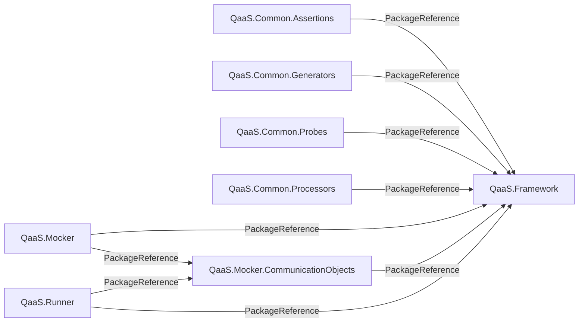

# QaaS ecosystem graph

This repository is the reproducible architecture map for the QaaS repositories.
It keeps two complementary views:

**[Open the interactive QaaS ecosystem graph](https://thesmoketeam.github.io/qaas-graph/)**

- `graphs/repositories.json` is the evaluated MSBuild dependency model. It records repositories, projects, published package identities, `ProjectReference` edges, `PackageReference` edges, versions, target frameworks, evaluation modes, and source commit SHAs.
- `graphify-out/graph.json` and `graphify-out/graph.html` are the merged code-level Graphify graph and interactive visualization.

Arrows point from the consuming repository to the repository that produces its dependency.

<!-- repository-graph:start -->

<!-- repository-graph:end -->

## Update the graphs

Graph creation is CI-only. Do not clone the QaaS source repositories or regenerate
graph artifacts on a workstation.

To request an update, run the
[Update ecosystem graphs workflow](https://github.com/TheSmokeTeam/qaas-graph/actions/workflows/update-graphs.yml)
from the GitHub Actions page. The same workflow accepts the
`qaas-package-mirror-synced` repository-dispatch event emitted after a successful
full `QaaS.PackageMirror` sync. It has no scheduled run.

The workflow checks out every source repository, runs the tests, creates both graph
views, and opens or refreshes the `automation/update-graphs` pull request when the
committed artifacts changed. Review and merge that pull request entirely on GitHub.
`scripts/generate.sh` intentionally refuses to run outside GitHub Actions so the CI
environment remains the single graph producer.

### Automation flow

1. A full PackageMirror sync is started with `workflow_dispatch`.
2. If the sync fails, the chain stops. If it succeeds, PackageMirror dispatches
   the `qaas-package-mirror-synced` event to this repository.
3. The `Update ecosystem graphs` workflow checks out the registered source
   repositories, runs the tests, and regenerates the graph artifacts.
4. If the artifacts are unchanged, the workflow finishes without a pull request.
5. If they changed, the workflow opens or updates the
   `automation/update-graphs` pull request.
6. Merging that pull request into `main` starts the `Deploy interactive graph`
   workflow, which publishes the interactive graph to GitHub Pages.

### How artifact changes are detected

An artifact in this repository is a file generated from the checked-out QaaS
source repositories rather than written manually. The committed graph artifacts
are `graphs/repositories.json`, `graphs/repositories.mmd`,
`graphs/repositories.svg`, `graphify-out/graph.json`, and
`graphify-out/graph.html`. The generated Mermaid block in `README.md` is checked
at the same time.

After regeneration, the workflow runs:

```bash
git diff --quiet -- README.md graphs graphify-out
```

Git compares the regenerated contents with the versions in the commit that the
workflow checked out. File timestamps do not matter. If all tracked contents are
identical, the command succeeds and the workflow exits without creating a pull
request. If any content differs, the command reports a difference and CI commits
those paths to `automation/update-graphs`, then opens or updates its pull request.

This use of *artifact* is distinct from a temporary GitHub Actions artifact. The
graph files above are committed repository outputs. During deployment,
`actions/upload-pages-artifact` separately packages `graphify-out/graph.html` for
GitHub Pages.

Two PackageMirror modes intentionally do not dispatch a graph update:

- A push-validation run on PackageMirror `master` only builds and tests the mirror
  implementation; it does not rebuild mirrored packages or schemas.
- A run with `docs_drift_check_only: true` verifies generated documentation without
  performing the normal mirror update.

The PackageMirror `PACKAGE_MIRROR_TOKEN` must have `Contents: write` access to this
repository so it can create the repository-dispatch event.

The dependency extractor calls `dotnet msbuild` with `-getProperty` and `-getItem`,
so imported props/targets and conditional items are evaluated by MSBuild rather than
guessed from XML. If a repository needs more than one CI evaluation mode, declare
them under `evaluations` in `repositories.yml`; their references are merged while
the evaluation names remain attached to each edge.

## Outputs

| Path | Purpose | Commit? |
| --- | --- | --- |
| `repositories.yml` | Explicit source repository registry and MSBuild evaluations | Yes |
| `graphs/repositories.json` | Detailed deterministic .NET dependency data | Yes |
| `graphs/repositories.mmd` | GitHub-renderable Mermaid source | Yes |
| `graphs/repositories.svg` | Standalone repository overview | Yes |
| `graphify-out/graph.json` | Merged code knowledge graph | Yes |
| `graphify-out/graph.html` | Interactive code graph | Yes |
| `.graphify-cache/` | Per-repository extraction cache | No |

`.gitignore` keeps runtime state, environments, test caches, temporary Graphify
files, and `.graphify-cache/` out of commits while deliberately leaving the final
`graphs/` and `graphify-out/` artifacts visible to Git.
`.graphifyignore` is separate: it prevents Graphify from recursively indexing
the generated graph data if this repository itself is scanned. Source-repository
scans continue to respect each source repository's own ignore rules.

Code-only checks may still be run locally; they do not update graph artifacts:

```bash
python3 -m unittest discover -s tests -v
```

## CI

`.github/workflows/update-graphs.yml` is the only supported graph-generation entry
point. It rebuilds the graphs on demand or after a `qaas-package-mirror-synced`
dispatch. It records each checked-out source commit in `graphs/repositories.json`
and opens or updates an `automation/update-graphs` pull request when committed
artifacts change. Private source repositories require a `QAAS_GRAPH_TOKEN`
repository secret with read access; public repositories can use the workflow token.

`.github/workflows/deploy-pages.yml` publishes `graphify-out/graph.html` as the
site root whenever generated graph artifacts or the deployment workflow change on
`main`. The live site is available at <https://thesmoketeam.github.io/qaas-graph/>.
