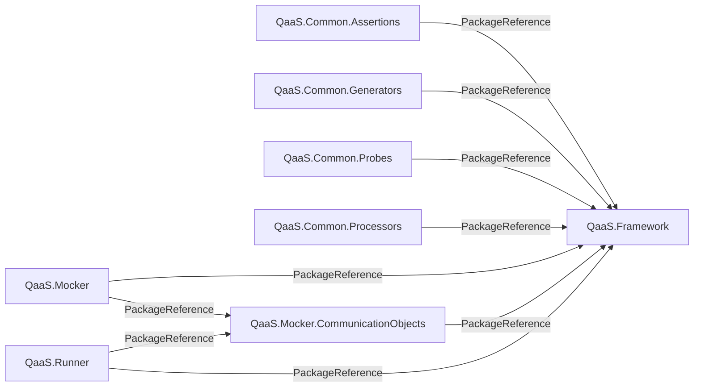

# QaaS ecosystem graph

This repository is the reproducible architecture map for the QaaS repositories.
It keeps two complementary views:

- `graphs/repositories.json` is the evaluated MSBuild dependency model. It records repositories, projects, published package identities, `ProjectReference` edges, `PackageReference` edges, versions, target frameworks, evaluation modes, and source commit SHAs.
- `graphify-out/graph.json` and `graphify-out/graph.html` are the merged code-level Graphify graph and interactive visualization.

Arrows point from the consuming repository to the repository that produces its dependency.

<!-- repository-graph:start -->

<!-- repository-graph:end -->

## Generate locally

The source repositories must be sibling directories of this repository, as declared in `repositories.yml`.

```bash
python3 -m pip install -r requirements.txt
scripts/generate.sh
```

Useful narrower commands:

```bash
# Fast, deterministic .NET architecture graph only
scripts/generate.sh --dependencies-only

# Code-level Graphify extraction and merge only
scripts/generate.sh --graphify-only

# Force Graphify to rescan every source repository
scripts/generate.sh --graphify-only --force
```

The dependency extractor calls `dotnet msbuild` with `-getProperty` and `-getItem`, so imported props/targets and conditional items are evaluated by MSBuild rather than guessed from XML. If local development and CI use different MSBuild properties, add both modes under `evaluations` in `repositories.yml`; their references are merged while the evaluation names remain attached to each edge.

## Outputs

| Path | Purpose | Commit? |
| --- | --- | --- |
| `repositories.yml` | Explicit source repository registry and MSBuild evaluations | Yes |
| `graphs/repositories.json` | Detailed deterministic .NET dependency data | Yes |
| `graphs/repositories.mmd` | GitHub-renderable Mermaid source | Yes |
| `graphs/repositories.svg` | Standalone repository overview | Yes |
| `graphify-out/graph.json` | Merged code knowledge graph | Yes |
| `graphify-out/graph.html` | Interactive code graph | Yes |
| `.graphify-cache/` | Per-repository extraction cache | No |

`.gitignore` keeps machine-local state, environments, test caches, temporary
Graphify files, and `.graphify-cache/` out of commits while deliberately leaving
the final `graphs/` and `graphify-out/` artifacts visible to Git.
`.graphifyignore` is separate: it prevents Graphify from recursively indexing
the generated graph data if this repository itself is scanned. Source-repository
scans continue to respect each source repository's own ignore rules.

Run the extractor tests with:

```bash
python3 -m unittest discover -s tests -v
```

## CI

`.github/workflows/update-graphs.yml` rebuilds the graphs weekly or on demand. It records each checked-out source commit in `graphs/repositories.json` and opens or updates an `automation/update-graphs` pull request when committed artifacts change. Private source repositories require a `QAAS_GRAPH_TOKEN` repository secret with read access; public repositories can use the workflow token.
